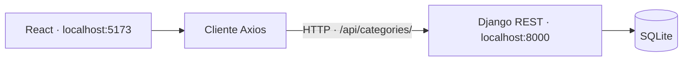

# Laboratorio 12 · Consumo de una API REST desde React

El laboratorio conecta el proyecto React de Cine Aurora (Lab 11) con la API Django REST del Lab 8. La integración usa Axios para consultar categorías de la cartelera, admite operaciones de alta y borrado en el cliente de la API y muestra los estados de carga, datos y error en la interfaz.

## Arquitectura



| Capa | Carpeta | Responsabilidad |
| --- | --- | --- |
| Cliente | `Lab11/` | Vite sirve la cartelera y la página `/categorias`. Axios centraliza las peticiones a Django. |
| Servidor | `Servicios_web-Django-Lab08/` | Django REST Framework expone los recursos en JSON y `django-cors-headers` autoriza el origen de React. |
| Datos | SQLite local de Django | Guarda las categorías que devuelve la API, incluidos los géneros de ejemplo de Cine Aurora. |

## Avance individual

Completé los pasos 1 a 6. Configuré CORS, verifiqué las rutas de Django, incorporé Axios y conecté el listado de categorías con carga, tabla paginada y error con reintento. El alta y el borrado desde la interfaz, las pruebas provocadas y la entrega corresponden a los pasos 7 a 13 asignados a mi compañero.

Consulta el [avance detallado y la captura](docs/avance.md).

## Servidor Django

En una terminal, desde la raíz del repositorio:

```bash
cd Servicios_web-Django-Lab08
python3 -m venv .venv
source .venv/bin/activate
python -m pip install -r requirements.txt
python manage.py migrate
python manage.py seed_blog
python manage.py runserver localhost:8000
```

`seed_blog` carga datos de ejemplo en la base SQLite local y reemplaza los registros de muestra existentes. Para actualizar una base del laboratorio con datos que quieras conservar, ejecuta solo `python manage.py migrate`. La migración actualiza las categorías originales de muestra que coinciden con los datos anteriores y conserva sus identificadores y relaciones.

## Rutas de la API

Se abrió la raíz en Chromium y Django REST Framework mostró **HTTP 200 OK** con enlaces a categorías, artículos y comentarios. El cliente del laboratorio consume categorías.

| Petición | URL | Respuesta |
| --- | --- | --- |
| `GET` | `http://localhost:8000/api/` | Índice de recursos de Django REST Framework. |
| `GET` | `http://localhost:8000/api/categories/` | Categorías paginadas en `results`, con `count`, `next` y `previous`. |
| `POST` | `http://localhost:8000/api/categories/` | Crea una categoría con `name`, `slug` y `description` opcional. |
| `DELETE` | `http://localhost:8000/api/categories/<slug>/` | Elimina la categoría indicada por su `slug` y devuelve `204` si tiene éxito. |

El listado devolvió HTTP 200 con cinco categorías después de ejecutar `seed_blog`. En las rutas `/api/`, Django envía `Access-Control-Allow-Origin: http://localhost:5173` para el origen del cliente React. Una petición de prueba desde `http://localhost:5174` obtuvo la respuesta sin esa cabecera.

## Cliente React

En otra terminal, desde la raíz del repositorio:

```bash
cd Lab11
npm ci
npm run dev
```

Abrir `http://localhost:5173`. Vite utiliza ese puerto para coincidir con el origen autorizado por Django.

Seleccionar **Categorías** en la navegación o abrir `http://localhost:5173/categorias`. La página solicita la primera página de categorías al entrar. El cliente Axios admite la variable `VITE_API_URL` para cambiar la dirección base de Django.

Las filas vienen de la base SQLite de Django a través de `GET /api/categories/`. Los géneros y sus descripciones se prepararon a partir de títulos y sinopsis de la cartelera ficticia, que se encuentran en `Lab11/src/datos/peliculas.js`. Django guarda esas categorías como registros independientes.

| Estado | Qué muestra el listado |
| --- | --- |
| Carga | Texto «Cargando categorías…» y un esqueleto de filas. |
| Datos | Tabla con nombre, `slug` y descripción, con navegación cuando hay más páginas. Si la lista está vacía, se muestra un mensaje. |
| Error | Motivo del fallo de conexión, tiempo de espera o código HTTP, y botón **Reintentar** para repetir la consulta en la misma página. |
