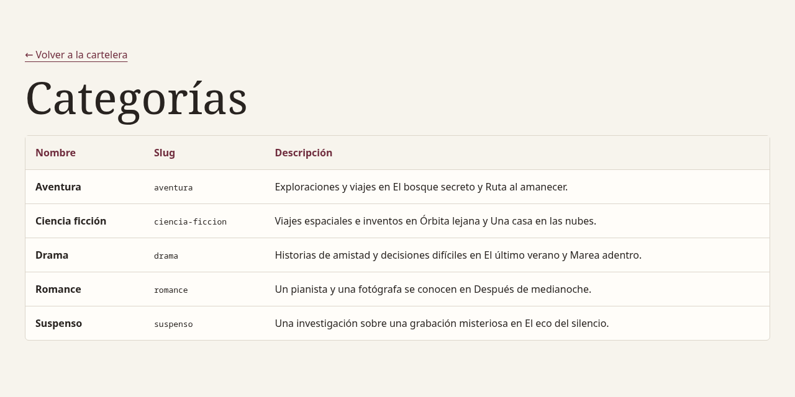

# Avance individual · Laboratorio 12

## Paso 1 · Levantar Django y configurar CORS

Puse en marcha la API del Lab 8 en `http://localhost:8000`. Añadí `corsheaders` a las aplicaciones instaladas y coloqué su middleware justo después de `SecurityMiddleware`. La configuración autoriza `http://localhost:5173` para las rutas `/api/`. Verifiqué que Django omitía la cabecera de autorización para `http://localhost:5174`.

**Archivos** · [requirements.txt](../Servicios_web-Django-Lab08/requirements.txt) declara `django-cors-headers` y [settings.py](../Servicios_web-Django-Lab08/blog/settings.py) configura CORS.

## Paso 2 · Verificar las rutas de la API

Abrí `http://localhost:8000/api/` en Chromium y confirmé que el índice de Django REST Framework devolvía `200 OK`. El laboratorio usa `GET` y `POST` en `/api/categories/` y `DELETE` en `/api/categories/<slug>/`. En el listado, las filas llegan en `results` junto a los datos de paginación.

**Archivo** · [README.md](../README.md) registra las rutas y cómo iniciar Django.

## Paso 3 · Incorporar React e instalar Axios

Incorporé el proyecto de Cine Aurora del Lab 11 a la carpeta de la sesión y ejecuté `npm install axios`. Fijé el puerto de Vite en `5173` para que el navegador usara el origen autorizado.

**Archivos** · [package.json](../Lab11/package.json) declara Axios, [package-lock.json](../Lab11/package-lock.json) fija las versiones instaladas y [vite.config.js](../Lab11/vite.config.js) configura el origen de desarrollo.

## Paso 4 · Centralizar las operaciones con Axios

Creé un cliente con `http://localhost:8000/api/` como dirección base. El módulo exporta `listarCategorias`, `crearCategoria` y `eliminarCategoria`. El borrado recibe el `slug` de la categoría. Verifiqué las tres operaciones contra Django con un registro temporal que eliminé al terminar.

**Archivo** · [categorias.js](../Lab11/src/api/categorias.js) define el cliente y las tres funciones.

## Paso 5 · Consultar los datos al abrir el listado

Conecté la opción **Categorías** de la cartelera con `/categorias`. Al montar la página, `useEffect` llama a `listarCategorias` y el componente mantiene los estados de datos, carga y error. Si la página se desmonta mientras la consulta está pendiente, la petición se cancela.

**Archivos** · [Categorias.jsx](../Lab11/src/paginas/Categorias.jsx) contiene la consulta y los estados, [main.jsx](../Lab11/src/main.jsx) monta la página según la ruta y [cine.js](../Lab11/src/datos/cine.js) incorpora el enlace en la navegación.

## Paso 6 · Representar carga, datos y error

| Estado | Qué muestra la página |
| --- | --- |
| Carga | El texto «Cargando categorías…» y un esqueleto de filas mientras responde Django. |
| Datos | Una tabla con nombre, `slug` y descripción. Si hay más páginas, aparecen los controles de navegación. Si la respuesta está vacía, se muestra un mensaje. |
| Error | Un mensaje según el fallo y el botón **Reintentar**, que repite la consulta en la misma página. |

Verifiqué en Chromium la carga, la tabla con datos reales y la recuperación mediante **Reintentar** después de simular un fallo de conexión en la petición.

**Archivos** · [Categorias.jsx](../Lab11/src/paginas/Categorias.jsx) renderiza los tres estados y [categorias.css](../Lab11/src/paginas/categorias.css) define su presentación.

### Datos de Cine Aurora y evidencia

Las filas se consultan en `GET /api/categories/` y se guardan en SQLite. Los géneros y sus descripciones se prepararon a partir de los títulos y sinopsis de [peliculas.js](../Lab11/src/datos/peliculas.js). [seed_blog.py](../Servicios_web-Django-Lab08/blog_app/management/commands/seed_blog.py) carga esos datos de ejemplo y la [migración 0004](../Servicios_web-Django-Lab08/blog_app/migrations/0004_datos_categorias_cine.py) actualiza las filas de ejemplo existentes.

*Captura de `/categorias` en Chromium tras recibir HTTP 200 de la API local. La tabla muestra los cinco géneros de Cine Aurora.*
