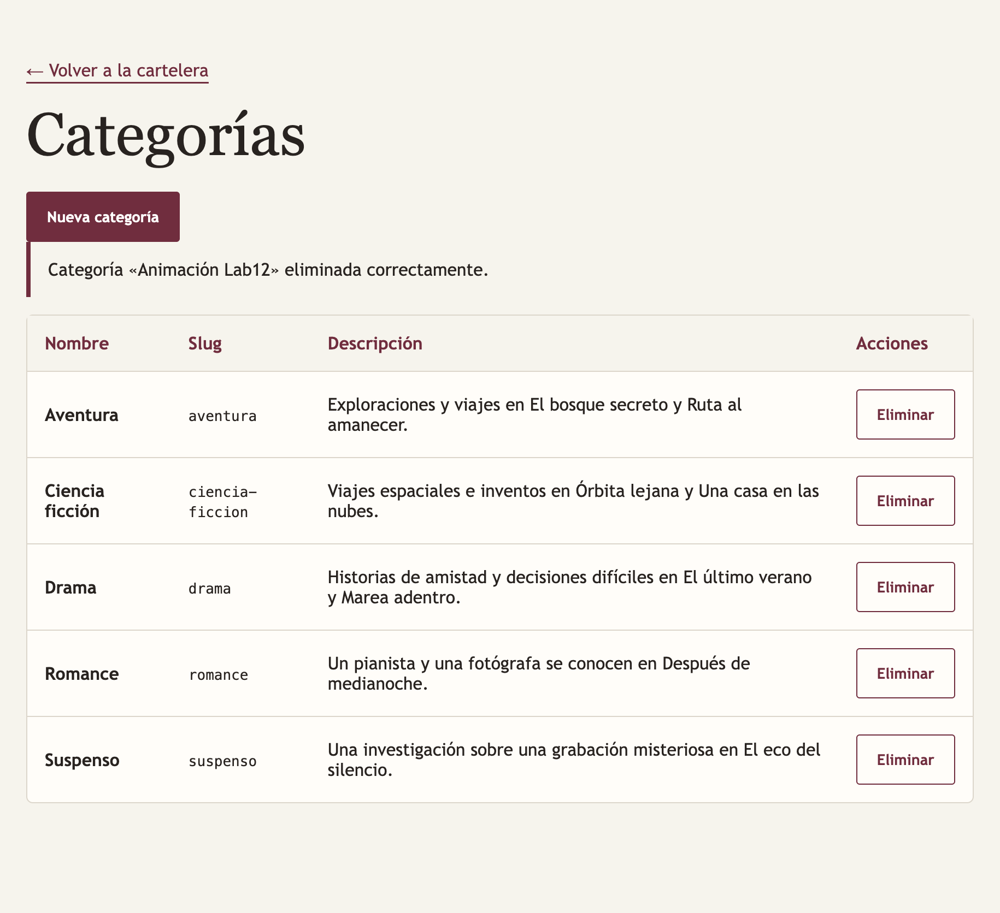
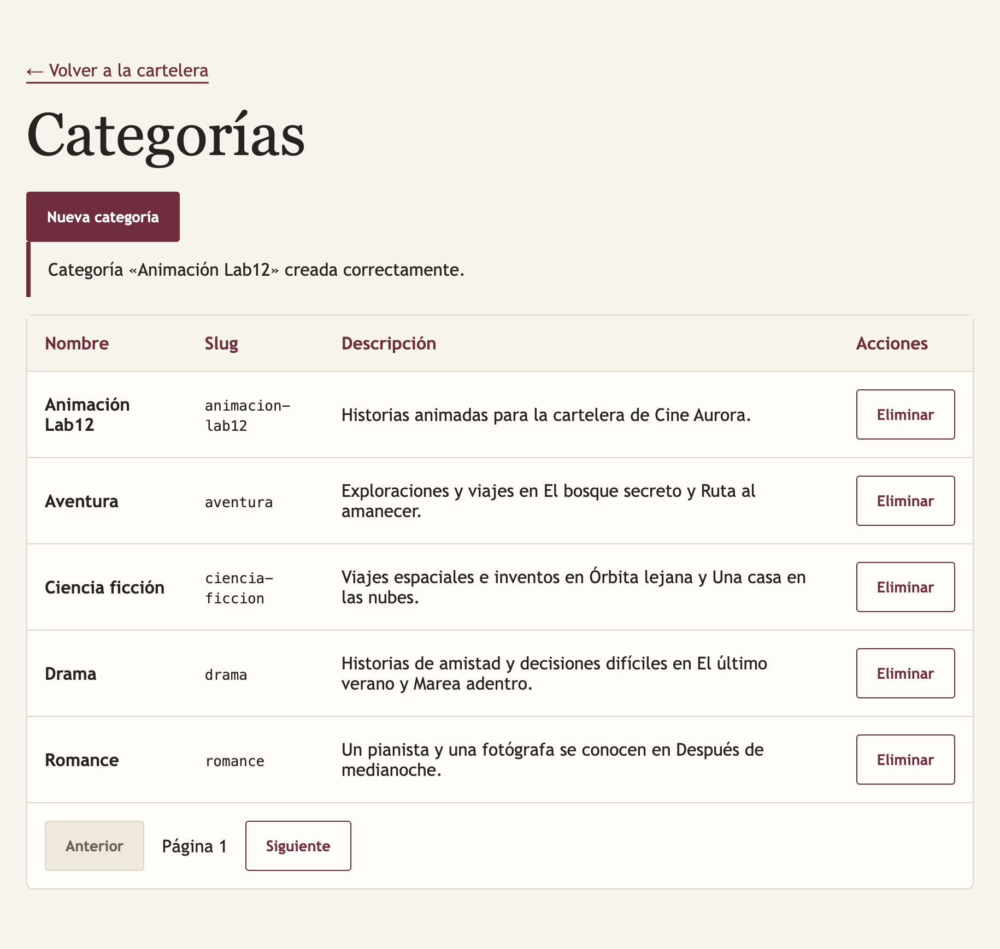
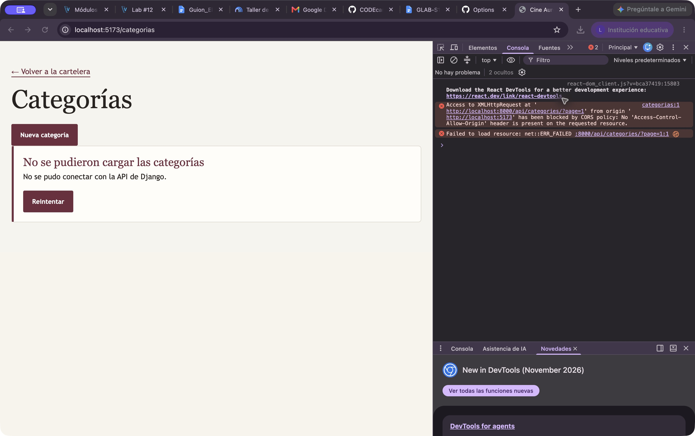
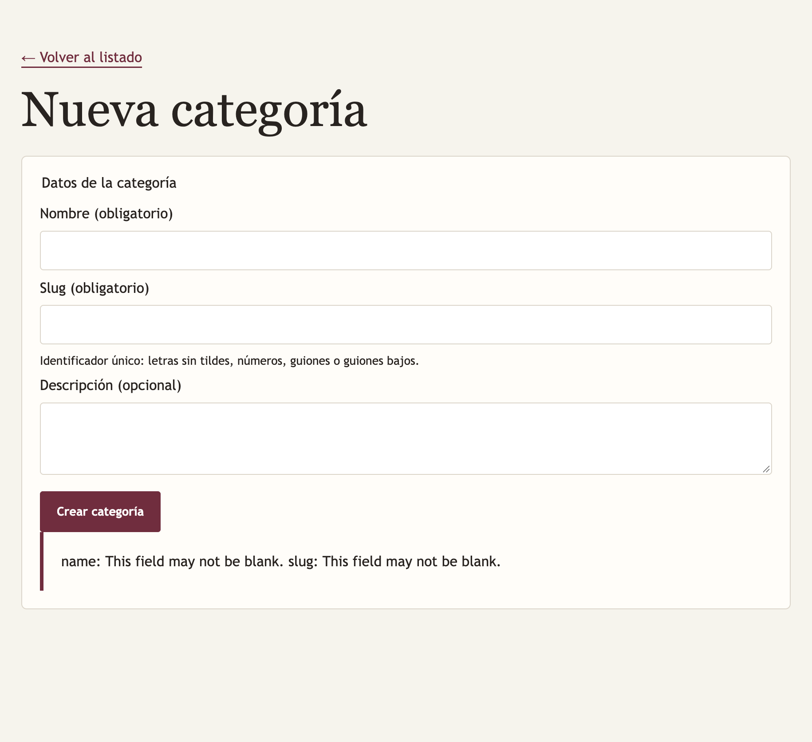
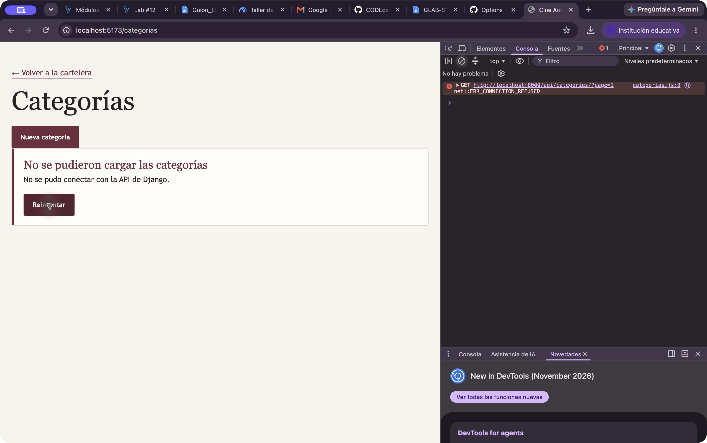
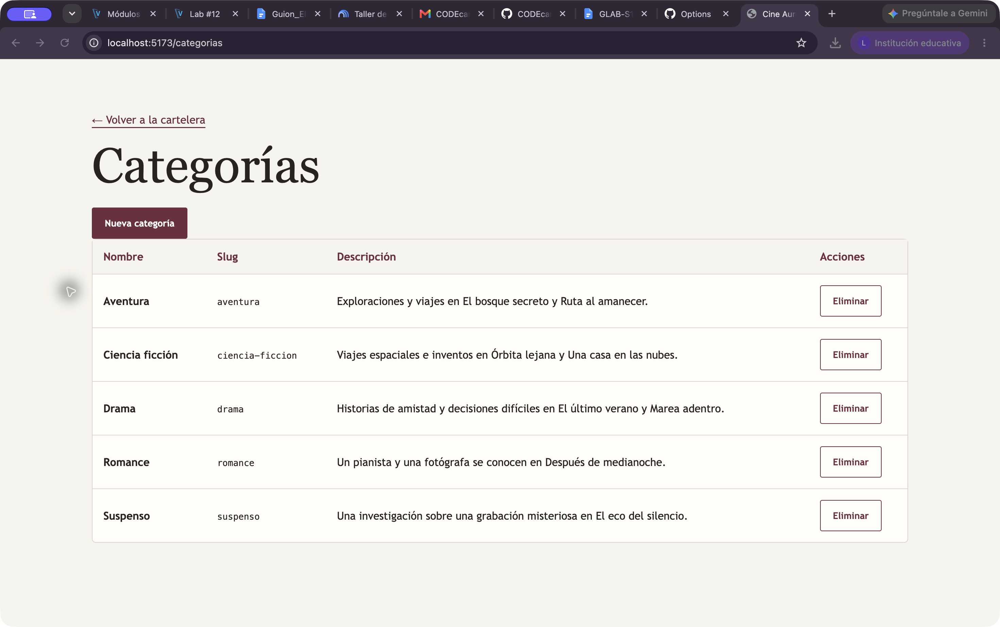

# Avance individual · Laboratorio 12

## Paso 1 · Levantar Django y configurar CORS

Puse en marcha la API del Lab 8 en `http://localhost:8000`. Añadí `corsheaders` a las aplicaciones instaladas y coloqué su middleware justo después de `SecurityMiddleware`. La configuración autoriza `http://localhost:5173` para las rutas `/api/`. Verifiqué que Django omitía la cabecera de autorización para `http://localhost:5174`.

**Archivos** · [requirements.txt](../Servicios_web-Django-Lab08/requirements.txt) declara `django-cors-headers` y [settings.py](../Servicios_web-Django-Lab08/blog/settings.py) configura CORS.

## Paso 2 · Verificar las rutas de la API

Abrí `http://localhost:8000/api/` en Chromium y confirmé que el índice de Django REST Framework devolvía `200 OK`. El laboratorio usa `GET` y `POST` en `/api/categories/` y `DELETE` en `/api/categories/<slug>/`. En el listado, las filas llegan en `results` junto a los datos de paginación.

**Archivo** · [README.md](../README.md) registra las rutas y cómo iniciar Django.

## Paso 3 · Incorporar React e instalar Axios

Incorporé el proyecto de Cine Aurora del Lab 11 a la carpeta de la sesión y ejecuté `npm install axios`. Fijé el puerto de Vite en `5173` para que el navegador usara el origen autorizado.

**Archivos** · [package.json](../Lab11/package.json) declara Axios, [package-lock.json](../Lab11/package-lock.json) fija las versiones instaladas y [vite.config.js](../Lab11/vite.config.js) configura el origen de desarrollo.

## Paso 4 · Centralizar las operaciones con Axios

Creé un cliente con `http://localhost:8000/api/` como dirección base. El módulo exporta `listarCategorias`, `crearCategoria` y `eliminarCategoria`. El borrado recibe el `slug` de la categoría. Verifiqué las tres operaciones contra Django con un registro temporal que eliminé al terminar.

**Archivo** · [categorias.js](../Lab11/src/api/categorias.js) define el cliente y las tres funciones.

## Paso 5 · Consultar los datos al abrir el listado

Conecté la opción **Categorías** de la cartelera con `/categorias`. Al montar la página, `useEffect` llama a `listarCategorias` y el componente mantiene los estados de datos, carga y error. Si la página se desmonta mientras la consulta está pendiente, la petición se cancela.

**Archivos** · [Categorias.jsx](../Lab11/src/paginas/Categorias.jsx) contiene la consulta y los estados, [main.jsx](../Lab11/src/main.jsx) monta la página según la ruta y [cine.js](../Lab11/src/datos/cine.js) incorpora el enlace en la navegación.

## Paso 6 · Representar carga, datos y error

| Estado | Qué muestra la página |
| --- | --- |
| Carga | El texto «Cargando categorías…» y un esqueleto de filas mientras responde Django. |
| Datos | Una tabla con nombre, `slug` y descripción. Si hay más páginas, aparecen los controles de navegación. Si la respuesta está vacía, se muestra un mensaje. |
| Error | Un mensaje según el fallo y el botón **Reintentar**, que repite la consulta en la misma página. |

Verifiqué en Chromium la carga, la tabla con datos reales y la recuperación mediante **Reintentar** después de simular un fallo de conexión en la petición.

**Archivos** · [Categorias.jsx](../Lab11/src/paginas/Categorias.jsx) renderiza los tres estados y [categorias.css](../Lab11/src/paginas/categorias.css) define su presentación.

### Datos de Cine Aurora y evidencia

Las filas se consultan en `GET /api/categories/` y se guardan en SQLite. Los géneros y sus descripciones se prepararon a partir de los títulos y sinopsis de [peliculas.js](../Lab11/src/datos/peliculas.js). [seed_blog.py](../Servicios_web-Django-Lab08/blog_app/management/commands/seed_blog.py) carga esos datos de ejemplo y la [migración 0004](../Servicios_web-Django-Lab08/blog_app/migrations/0004_datos_categorias_cine.py) actualiza las filas de ejemplo existentes.


*Captura de `/categorias` en Chromium tras recibir HTTP 200 de la API local. La tabla muestra los cinco géneros de Cine Aurora.*

## Paso 7 · Añadir el borrado

Añadí una acción por fila con confirmación en la interfaz. El botón llama a `eliminarCategoria(slug)` y espera el `204` de Django antes de volver a consultar la lista. La tabla se actualiza sin recargar la página. Si se elimina la última fila de una página, retrocede a la anterior. Verifiqué el borrado de la categoría temporal «Animación Lab12» desde Chrome; después quedaron los cinco géneros originales.

**Archivos** · [Categorias.jsx](../Lab11/src/paginas/Categorias.jsx) y [categorias.js](../Lab11/src/api/categorias.js).



## Paso 8 · Crear la página de alta

Creé `/categorias/nueva` con entradas controladas mediante `useState`. `onSubmit` usa `preventDefault()` y envía `name`, `slug` y `description` con Axios. Tras recibir `201`, React navega al listado con `history.pushState`, consulta los datos y muestra el mensaje de éxito. Los campos y el botón se desactivan mientras se guarda. Creé «Animación Lab12» y comprobé que aparecía al volver al listado.

**Archivos** · [NuevaCategoria.jsx](../Lab11/src/paginas/NuevaCategoria.jsx), [Paginas.jsx](../Lab11/src/Paginas.jsx) y [categorias.js](../Lab11/src/api/categorias.js).



## Paso 9 · Provocar y restaurar CORS

Retiré temporalmente `http://localhost:5173` de `CORS_ALLOWED_ORIGINS`, reinicié Django y recargué el listado en Chrome. Django respondió al GET, pero el navegador bloqueó la lectura del resultado y la interfaz mostró su panel de error con **Reintentar**. La consola registró:

```text
Access to XMLHttpRequest at 'http://localhost:8000/api/categories/?page=1'
from origin 'http://localhost:5173' has been blocked by CORS policy:
No 'Access-Control-Allow-Origin' header is present on the requested resource.
```

Restauré la configuración original y reinicié Django. El listado volvió a cargar los cinco géneros. [settings.py](../Servicios_web-Django-Lab08/blog/settings.py) conserva solamente el origen autorizado; no se publicó la configuración temporal.



## Paso 10 · Mostrar la validación de la API

Envié `name` y `slug` vacíos desde el formulario en Chrome. La API respondió `400` con `This field may not be blank.` para ambos campos. La página conservó el formulario y mostró esos mensajes. `noValidate` permite que este caso llegue al servidor en lugar de detenerse en el navegador. [describirError.js](../Lab11/src/api/describirError.js) muestra los errores de campo devueltos por Django.



## Paso 11 · Apagar Django con React abierto

Detuve Django y pulsé **Reintentar** en React. La consola registró `GET http://localhost:8000/api/categories/?page=1 net::ERR_CONNECTION_REFUSED`. La aplicación mantuvo la navegación y el panel «No se pudieron cargar las categorías», con el motivo y **Reintentar**. No quedó en blanco. Después reinicié Django y comprobé que volvía a cargar los datos.



## Paso 12 · Tabla de la pantalla y evidencias

| Pantalla / petición | Carga | Datos / éxito | Error |
| --- | --- | --- | --- |
| `/categorias`: GET `/api/categories/?page=1` al entrar | «Cargando categorías…» y esqueleto | Tabla, paginación y mensaje de lista vacía | Panel con motivo y **Reintentar** |
| `/categorias/nueva`: sin petición al entrar; POST al enviar | «Guardando…» y campos desactivados | `201`: navega al listado y muestra confirmación | `400`: mensajes de la API y valores conservados |
| Listado: DELETE al confirmar | «Eliminando…» y acciones desactivadas | `204`: nueva consulta y confirmación | Mensaje del fallo; no se borra la fila localmente antes del éxito |

Las capturas de los puntos 9 y 10 documentan los dos errores provocados. El punto 11 añade la desconexión del servidor. La siguiente captura muestra la recuperación con CORS restaurado y Django funcionando.



**Validación adicional** · Pasaron `npm run lint`, `npm run build`, `npm test` y `python manage.py check`. Se comprobaron mediante Axios GET paginado, POST correcto, duplicados e identificador inválido (`400`), DELETE correcto (`204`), DELETE inexistente (`404`) y la cabecera CORS del origen de React. Los registros temporales se eliminaron al finalizar.

## Paso 13 · Repositorio y entregable

El repositorio reúne el cliente `Lab11/`, el servidor `Servicios_web-Django-Lab08/`, instrucciones de ejecución y evidencias. El [documento compartido del laboratorio](https://docs.google.com/document/d/1IznOdCkEk4z_GaLl0GDVS-xth8FGnFo1/edit) contiene el desarrollo de los puntos 7 a 12 bajo sus consignas. La presentación en el campus debe verificarse en la actividad correspondiente; no se afirma una entrega sin su comprobante.
